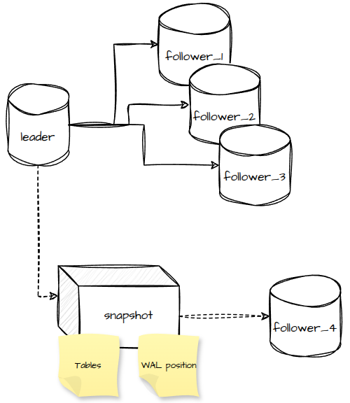

# Replicação Síncrona - Adicionando Um Novo Follower Em Produção

# Introdução

No [artigo anterior](https://medium.com/@gtbarbosa/replica%C3%A7%C3%A3o-s%C3%ADncrona-o-que-ela-garante-e-quanto-custa-single-leader-replication-a25833391423), nós destrinchamos conceitualmente como funciona a **Replicação Síncrona de Dados** e algumas das principais preocupações que precisamos ter ao usar este tipo de arquitetura.

Um tópico importante, que vale um artigo a parte e que vamos destrinchar neste artigo é, como adicionamos uma nova réplica do banco, sem causar *downtime* na nossa aplicação e como esta réplica recebe os dados históricos das demais réplicas.

Na medida em que nossa aplicação cresce, é natural que tenhamos que adotar estratégias que melhorem sua performance e uma das estratégias pode ser adicionar uma nova réplica do banco de dados, pensando em:

- Melhorar throughput de leitura; ou
- Aproximar os dados em uma região geográfica que estejam mais próximas dos usuários.

# Adicionando Um Novo Follower

Em arquiteturas mais modernas, usando algum Cloud Provider, adicionar um novo follower pode ser, aparentemente, uma tarefa simples. No entanto, o que realmente acontece, é uma tarefa mais complexa e que exige alguns cuidados, a fim de garantir a consistência dos dados entre todas as réplicas.

## Snapshot e Posição do WAL

Vamos relembrar alguns pontos. Primeiro, o *snapshot* nada mais é do que uma foto do estado atual de um banco de dados. Segundo, o WAL é um acrônimo para *Write Ahead Log* e é a partir dele que o banco sabe o que ele precisa escrever de fato nas tabelas (para maiores detalhes, [leia o primeiro artigo desta série de replicação](https://medium.com/@gtbarbosa/replica%C3%A7%C3%A3o-s%C3%ADncrona-o-que-ela-garante-e-quanto-custa-single-leader-replication-a25833391423)).

Quando adicionamos uma nova réplica em nossa arquitetura, precisamos garantir que ela contenha os dados históricos, a fim de garantir a consistência dos dados entre todas as réplicas. Para isso, no processo de adicionar uma nova réplica, o primeiro passo é fazer o *snapshot* de uma das réplicas já presentes na arquitetura, geralmente do *leader*. Neste *snapshot* a gente também vai capturar a posição em que o WAL está e isso é importante, por que novas escritas continuam acontecendo e também queremos garantir que elas cheguem na nova réplica.

## Garantindo Sequencialidade Nos Dados

Uma vez que a gente tenha o *snapshot* na nova réplica e ela esteja pronta para se conectar ao *leader*, precisamos então sincronizá-la com os dados que foram escritos durante o processo de captura, transporte e restauração do *snapshot* e é por isso que temos a posição do WAL no *snapshot*.

Quando a nova réplica se conecta ao *leader* pelo *replication stream* em modo *standby*, inicia-se o processo de sincronização dos dados. A réplica pede ao *leader*, através da posição do WAL, os dados que ela precisa receber. É algo como: *me dê tudo a partir da posição 123 do WAL*.

A partir da posição indicada, o *leader* lê o WAL e envia os dados de forma ordenada, garantindo sequencialidade dos dados.

> O modo `standby` indica que é um banco de dados réplica, que recebe dados vindos de um leader e que não aceita escritas diretamente.

> A posição do WAL é um valor crescente, representado em hexadecimal. O 123 é apenas um exemplo.

Todas as operações citadas acontecem enquanto o *leader* continua recebendo escritas, ou seja, a réplica está correndo atrás de algo que continua se movendo. Quando a réplica chega na mesma posição do WAL que o *leader* está, chamamos isso de *catch-up* e então a nova réplica passa a receber os dados praticamente em tempo real, conforme vimos no [artigo anterior](https://medium.com/@gtbarbosa/replica%C3%A7%C3%A3o-s%C3%ADncrona-o-que-ela-garante-e-quanto-custa-single-leader-replication-a25833391423). Tudo isso pressupõe que o *leader* ainda tem o WAL desde a posição do *snapshot*. Mas será que ele tem?

# Lidando Com Limpeza do WAL

Como no [primeiro artigo](https://medium.com/@gtbarbosa/replica%C3%A7%C3%A3o-s%C3%ADncrona-o-que-ela-garante-e-quanto-custa-single-leader-replication-a25833391423), o WAL é um arquivo de *logging* que armazena sequencialmente as operaçẽos de escrita no banco e isso tem um custo. Quanto mais dados retidos, maior o tamanho de ocupação em disco. Por isso, é comum que os bancos de dados, em determinado momento, façam a limpeza do WAL e isso traz um risco associado ao *setup* de uma nova réplica.

Para ambiente menores e menos críticos, este risco diminui, pois o processo de *setup* tende a ser mais rápido e menor, garantindo que tudo aconteça antes da reciclagem do WAL. Mas e se o WAL for reciclado durante o *setup* de uma nova réplica?

## Garantindo a Retenção do WAL

A solução mais trivial e mais simples é garantir um mínimo de retenção dos *logs*. A retenção é lidada de maneiras diferentes a depender do banco de dados que você esteja trabalhando, por isso, é extremamente importante conferir na documentação oficial. Para efeitos didáticos, abaixo vou deixar dois exemplos (PostgreSQL e MySQL).

- **PostgreSQL**: ele trabalha na retenção por tamanho. Na configuração do banco, você consegue determinar o tamanho mínimo de retenção de *logs*;

- **MySQL**: já o MySQL, lida com a retenção por tempo. Na configuração do banco, Você consegue determinar o tempo de retenção dos *logs*.

Desta forma, conseguimos lidar com uma nova réplica, garantindo que ela seja adicionada antes da remoção do WAL.

## Replication Slots

Outra forma de garantir que as réplicas recebam o WAL é configurando um **Replication Slot**. É uma maneira automatizada de reter os *logs* até que as réplicas os tenha recebido.

O *trade-off* mais importante aqui é que o banco pode reter mais *logs* do que o necessário e assim acabar estourando espaço em disco.

## Arquivamento do WAL

Outra estratégia pode ser, arquivar os *logs*. Isso garante uma cópia fiel dos *logs* reciclados ou removidos pelo banco.

Esse modelo precisa que, o banco esteja configurado para armazenar os *logs* em um *object storage*. No PostgreSQL por exemplo, você define um `archive_command`, que envia o arquivo para um local seguro. Para que a réplica consiga ler o WAL, você pode definir o `restore_command`.

# Fontes

- Backups (PostgreSQL): https://www.postgresql.org/docs/18/app-pgbasebackup.html
- Adicionando nova réplica (PostgreSQL): https://www.postgresql.org/docs/18/warm-standby.html
- Retenção por tamanho (PostgreSQL): https://www.postgresql.org/docs/18/runtime-config-replication.html#RUNTIME-CONFIG-REPLICATION
- Retenção por tempo (MySQL): https://dev.mysql.com/doc/refman/26.10/en/purge-binary-logs.html
- Replication Slots (PostgreSQL): https://www.postgresql.org/docs/18/warm-standby.html#STREAMING-REPLICATION-SLOTS
- WAL Archiving (PostgreSQL): https://www.postgresql.org/docs/current/runtime-config-wal.html#RUNTIME-CONFIG-WAL-ARCHIVING